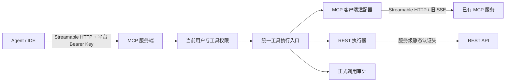

# MCP 能力、接入方式与 REST-to-MCP 调研

## 状态与范围

2026-11-21 发起、2026-11-22 完成的调研结论，供下一阶段实现规格使用。本文的建议尚未成为已确认产品决定，不取代既有产品规格和技术选型。本轮只修改文档和调研资料，没有实现 MCP、安装依赖或启动参考项目。

2026-11-22 澄清补充：用户已逐项选择本轮范围和行为，汇总在 [MCP/REST 接入规格](20261122-mcp-rest-integration.md)，整体待最后确认。本文建议继续保留为调研历史；同轮交付、凭证明文、网络不额外限制、可改命名空间、个人累计统计和 REST 正文透传等采用用户的明确取舍。

研究分别由子 agent 阅读 ContextForge 和 Supermux 源码，主 agent 核对本项目与官方协议/SDK 文档，并复核关键代码。参考仓库当时均无未提交修改：

| 对象 | 调研版本 |
| --- | --- |
| agent-capability-hub 基线 | `7ccf0b0da59e03138828777207fd01cc2514e8d4` |
| mcp-context-forge | `14a4c4a60cfa9dd8d7e04eb1711acf338676f938` |
| supermux | `d6db5b78c656beaad998fac5dc02e1b9a9ee8aca` |

“已实现”在本文表示存在实际源码路径，不表示本轮已验证运行效果。跨客户端互操作、会话释放、并发和断线行为仍需后续技术验证。

## 结论

1. 本项目适合先做**工具网关**：上游原生 `tools/list`、`tools/call`，下游 Streamable HTTP / 旧 SSE；MCP 原生下游和 REST 执行器共用工具目录、角色授权和正式调用审计。
2. MCP 不只有工具，还包括 resources、prompts、用户补充输入、订阅及扩展。本期不应因下游支持这些能力就宣称网关能够完整透传。
3. **协议版本必须显式纳入接入契约。** 官方已发布 `2026-07-28`：取消旧握手及协议会话，增加逐请求元数据、`server/discover` 和新的订阅机制。继续只按 2025 年教程设计会导致兼容问题。
4. 官方 TypeScript SDK v2 已是稳定版本，拆包为 `@modelcontextprotocol/server` / `client`，仍提供旧 SSE 客户端。符合当前 Node.js / TypeScript / Express 技术方向，无须为参考项目改换语言。
5. REST-to-MCP 应实现**明确支持范围的转换器和执行器**。生成 JSON Schema 只解决一部分问题；参数位置、编码、响应、鉴权、重试及更新语义才决定工具能否可靠调用。

## 当前项目已有与缺少的部分

已有本地账号、用户多角色、API Key 生命周期及资源权限。`/api/capabilities` 每次请求校验 Key 和用户，再计算当前角色权限：[resources.ts:86](/Users/wangx/workspace/aaa/github/agent-capability-hub/apps/api/src/resources.ts:86)。当前工具需要自身 ID 的显式授权；服务授权只影响服务目录可见性，并不会自动授权其全部子工具：[resources.ts:117](/Users/wangx/workspace/aaa/github/agent-capability-hub/apps/api/src/resources.ts:117)。

现有 `resources` 只有 ID、类型、父级和展示信息，没有 MCP URL、传输配置、原始工具名、schema、连接状态或调用审计表：[database.ts:35](/Users/wangx/workspace/aaa/github/agent-capability-hub/apps/api/src/database.ts:35)。API 包也尚未依赖 MCP SDK。demo 服务不是已经登记的真实下游。

后续需要补齐服务登记、下游发现、工具快照、名称映射、执行入口及审计。可以提取并复用现有认证/权限逻辑，但不能直接把 demo 列表改名为 MCP 工具列表。

## MCP 的能力与边界

| 能力 | 作用 | 对本项目的建议 |
| --- | --- | --- |
| Tools | 暴露操作，参数为 JSON Schema，结果可以是文本、媒体、资源链接及结构化数据 | 首阶段实现发现与调用，保留 schema 和结果语义 |
| Resources | 暴露上下文数据及 URI、模板、读取和更新能力 | 暂不代理；需要独立的 URI、权限及订阅设计 |
| Prompts | 暴露可带参数的消息模板 | 暂不代理；不能简单当作可调用工具 |
| Elicitation / MRTR | 服务请求用户补充输入；新版本通过中间结果及再次请求完成 | 首阶段不承诺透传，接入时明确不支持的能力 |
| 订阅、进度、取消 | 工具目录变化和请求过程控制 | 按协议版本处理，不把所有 SSE 流当作同一种流 |
| Tasks / Apps / Skills 等扩展 | 长任务、内嵌交互界面、工作流指令等 | 需双方显式支持；本期不自动开启，不替代现有 Skills 广场规格 |

工具的 `annotations` 是行为提示，不是权限规则或安全证明。`readOnlyHint`、`idempotentHint` 等不可信下游声明不能替代角色授权、人工控制或重试策略。

工具名只保证在一个服务器内唯一，`serverInfo.name` 也不保证全局唯一。聚合需要稳定命名空间与显式路由映射。官方建议工具名使用 ASCII 字母、数字、下划线、连字符和点，长度 1–128；还需验证目标客户端是否更严格。[工具规范](https://modelcontextprotocol.io/specification/2026-07-28/server/tools)

## 接入方式与版本兼容

### 网关是两个独立的协议端点

平台对 Agent 是 MCP server，对原生 MCP 下游是 MCP client。两侧的版本、能力和凭证独立；不能把 Agent 的 Bearer Key、请求 ID 或旧会话 ID 原样当作下游身份和会话。

| 方式 | 接入形态与限制 |
| --- | --- |
| Streamable HTTP，2026 版本 | 单个 POST 端点，可返回 JSON 或请求相关 SSE；没有协议会话、GET 流、DELETE 会话或 SSE 断点续传 |
| Streamable HTTP，2025 版本 | `initialize` / `notifications/initialized`；可能有会话 ID、GET 流、DELETE 和事件恢复；也可无状态运行 |
| 旧 HTTP+SSE | GET 接收流及 `endpoint` 事件，POST 发消息；已弃用，但现有下游仍需兼容 |
| stdio | 客户端启动本机子进程，涉及进程、环境变量及文件系统边界；本项目已明确排除 |
| 普通 REST API | 不是 MCP；需要操作定义、参数映射和响应转换后才成为工具 |

Streamable HTTP 使用 SSE 返回消息，不等于旧 HTTP+SSE 传输。服务登记界面应明确区分，不能仅保存一个含义不清的“SSE”选项。

### 2026-07-28 与旧版的重要差异

| 项目 | 2025-11-25 及之前 | 2026-07-28 |
| --- | --- | --- |
| 初始化 | 握手协商版本、能力和客户端身份 | 无握手；每次请求 `_meta` 声明版本/能力，客户端信息应逐请求提供 |
| 服务发现 | initialize 结果 | 必须实现 `server/discover` |
| HTTP 会话 | 可有 `Mcp-Session-Id` | 取消协议会话，业务状态用显式 handle |
| 长连接通知 | GET 流及旧订阅方法 | POST `subscriptions/listen` 响应流 |
| 服务请求额外输入 | 独立反向请求 | MRTR 的 `input_required` 结果及重试输入 |
| 结果 | 没有统一 resultType | 必须有 `resultType`；旧结果缺少该字段时按 complete 处理 |
| 列表缓存 | 不含新的统一缓存字段 | 列表等结果有 `ttlMs` / `cacheScope` |
| HTTP 请求元数据 | 旧协议头要求 | 逐请求版本头、`Mcp-Method`，特定方法还需 `Mcp-Name`，并校验头与正文一致 |

来源：[官方变更](https://modelcontextprotocol.io/specification/2026-07-28/changelog)、[版本兼容](https://modelcontextprotocol.io/specification/2026-07-28/basic/versioning)、[HTTP 传输](https://modelcontextprotocol.io/specification/2026-07-28/basic/transports/streamable-http)。不要把“无握手”误解成“无认证”，也不要把旧会话生命周期代码用于现代协议的全部请求。

2026 协议仍允许工具列表根据**每次请求的授权身份**变化。角色过滤与新协议兼容，但授权后的列表应按私有数据处理，不能复制下游的 public 缓存声明；建议初始 `ttlMs: 0`、`cacheScope: private`，执行时始终再校验权限。撤销权限后，客户端本地旧列表无法代表调用权限。

### SDK 接入建议

本轮 npm 元数据查询：`@modelcontextprotocol/server`、`@modelcontextprotocol/client` 均为 `2.4.0`；旧 `@modelcontextprotocol/sdk` 为 `1.32.2`。这些是调研时版本，实施时应锁定并验证，不使用浮动 latest 作为交付依据。

v2 提供 Express / Node 适配包；动态下游 schema 和统一处理器需要选择能够保留原始 JSON Schema 的 API。不能为了注册工具而把复杂 schema 粗略改成 `z.any()`。[SDK README](https://github.com/modelcontextprotocol/typescript-sdk)、[v2 文档](https://ts.sdk.modelcontextprotocol.io/v2/)

补充复核：官方 SDK main 的 `5ee54ee30ddc00a914a3d981880f87fdce0e6246` 源码中，client 默认 `versionNegotiation.mode = 'legacy'`，安装 v2 不会自动选择现代协议。连接现代和旧下游时应显式评估 `mode: 'auto'`，把版本协商与 HTTP/SSE 传输选择分开。鉴权拒绝和 HTTP 超时不是旧协议的证据，不能通过捕获所有异常就回退 SSE。[默认值源码](https://github.com/modelcontextprotocol/typescript-sdk/blob/5ee54ee30ddc00a914a3d981880f87fdce0e6246/packages/client/src/client/versionNegotiation.ts#L108)、[协商指南](https://github.com/modelcontextprotocol/typescript-sdk/blob/5ee54ee30ddc00a914a3d981880f87fdce0e6246/docs/protocol-versions.md)。本轮核对了 main 源码及 npm 版本元数据，没有运行 `2.4.0` 发布包；实施时仍需按锁定版本验证。

现有 Express 已执行 `express.json()`；接入 v2 Node 适配器时应传入解析后的 `req.body`，避免重复读取已耗尽的请求流。`createMcpHandler` 本身不验证 Bearer、Host 或 Origin，这些检查需要在路由入口完成。[Express 接入指南](https://github.com/modelcontextprotocol/typescript-sdk/blob/5ee54ee30ddc00a914a3d981880f87fdce0e6246/docs/serving/express.md)

官方 `createMcpHandler` 默认能服务旧客户端的无状态请求，但旧 GET / DELETE 会返回 405；这不等于完整支持旧客户端有状态连接。v2 client 保留 `SSEClientTransport`，无需为下游 SSE 引入旧 SSE 服务端包。[旧客户端兼容指南](https://ts.sdk.modelcontextprotocol.io/v2/serving/legacy-clients)

建议优先验证 v2 的现代上游、旧客户端无状态兼容，以及现代/旧版 Streamable HTTP 和旧 SSE 下游。若目标客户端需要旧有状态上游，再明确兼容范围。客户端配置样例要基于实测，不能仅因支持 HTTP 就宣称任意 IDE 均可连接。

### 身份与连接的坑

- 本项目已决定使用手动配置的 Bearer API Key。这能服务允许配置请求头的客户端，但不等于已实现 MCP OAuth 自动发现、授权和令牌流程；不能据此宣称通用 OAuth 兼容，也不应为了跟随示例擅自引入企业 IdP。
- 平台 Key 只识别平台用户；下游服务凭证独立保存和注入。忽略调用者试图伪造的用户头；客户端名称/版本只是来源标签。
- 列表和调用使用同一权限规则，调用前重新验证用户、Key、当前角色和工具状态。不能只在旧握手时校验，更不能只按 Session ID 放行。
- 若接入旧有状态下游，避免多个用户共用会改变行为的同一会话。池的隔离粒度应由下游状态和凭证范围决定；至少区分服务与凭证配置，发现状态关联用户时进一步隔离。
- 同一个用户的两个聊天也可能需要下游状态隔离。ContextForge 曾因按用户共享连接，让两个聊天共享计数器，之后改为调用方会话与下游服务共同确定连接；其测试可作为验收案例。[隔离修复](https://github.com/IBM/mcp-context-forge/issues/4205)、[本地隔离测试](/Users/wangx/workspace/aaa/github/mcp-context-forge/tests/integration/test_issue_4205_upstream_session_isolation.py:133)。2026 没有协议会话，不能为其凭空套用旧 session 映射；隐式跨调用业务状态是否支持仍需明确。
- 下游 `tools/list` 要处理分页；超时、连接断开、配置变更和服务删除都需释放 transport/client/订阅。一个服务失败不应让所有其他工具消失。
- 只有完整、成功的工具发现才能作为删除旧工具的依据。超时、分页失败或断线应更新服务可用性，不能被当成空目录而删除工具及授权；旧连接的迟到刷新也不能覆盖新连接结果。
- 旧 SSE 必须测试认证头在 GET 流和 `endpoint` 指定的消息 POST 上均正确注入，且 endpoint 不能改变已允许的目标 origin。Supermux 对这两条通道有明确实现和回归测试。[SSE 实现](/Users/wangx/workspace/lyy-workspace/gitlab/ai/infrastructure/supermux/crates/runtime/src/downstream/sse.rs:36)、[SSE 测试](/Users/wangx/workspace/lyy-workspace/gitlab/ai/infrastructure/supermux/crates/gateway/tests/it/sse.rs:53)
- HTTP 客户端必须能读 JSON 和 SSE；反向代理应避免 SSE 缓冲，并设合适的流超时。旧 SSE `endpoint`、重定向和 DNS 解析同样属于目标地址安全边界。
- 401/403 是认证/授权失败，不能任意回退成另一种传输；现代协议的 400 错误也不能一律当作旧协议，需识别错误正文。
- 验证 Origin/Host；为组织内网接入采用明确目标规则，而不是无条件阻断所有内网 IP，或因管理员登记就完全放弃 SSRF 检查。

## 两个参考仓库的实装对比

| 维度 | ContextForge | Supermux | 本项目取舍 |
| --- | --- | --- | --- |
| 架构 | Python 能力网关，注册表及服务层较完整 | Rust 模块化网关 | 保持 TypeScript / Express 模块化单体 |
| MCP 能力 | tools/resources/prompts 有实际处理器；有现代发现及旧兼容路径 | 主要为 tools；资源和 prompt 列表明确拒绝 | 首阶段仅工具，声明准确能力 |
| 聚合 | 虚拟服务与能力目录 | `/mcp` 只公开 search_tools/call_tool；单服务入口保留原名 | 原生 tools/list/tools/call，稳定名称映射 |
| 授权 | token scope、RBAC 动作及目标可见性分层检查 | 用户所属团队 allow 与服务工具规则 | 复用本项目用户多角色和显式工具授权 |
| 连接 | HTTP/SSE，默认无状态；有旧有状态及跨 worker 支持 | 上游新/旧处理器，下游主要旧 initialize；自建 SSE | 单实例先依赖官方 SDK，验证隔离和释放 |
| REST 转换 | 指定操作自动抽 schema + 独立、较丰富的手工执行配置 | 原始 spec 与 inline 导入两种路径，声明支持子集 | 统一内部操作模型，导入与手工共用执行器 |

### ContextForge 的可借鉴点和实际限制

协议分发注册 tools、resources、prompts 与 server/discover：[streamablehttp_transport.py:4432](/Users/wangx/workspace/aaa/github/mcp-context-forge/mcpgateway/transports/streamablehttp_transport.py:4432)。出站 HTTP/SSE 包装器：[mcp_proxy_client.py:141](/Users/wangx/workspace/aaa/github/mcp-context-forge/mcpgateway/utils/mcp_proxy_client.py:141)。工具执行既检查动作权限，又检查目标权限：[动作:2357](/Users/wangx/workspace/aaa/github/mcp-context-forge/mcpgateway/transports/streamablehttp_transport.py:2357)、[目标:5565](/Users/wangx/workspace/aaa/github/mcp-context-forge/mcpgateway/services/tool_service.py:5565)。这些分层值得借鉴；多 worker affinity、Redis 和巨型模块不属于本项目当前需求。

其 SDK v2 迁移仍有明确缺口：旧反向请求回复路径在 `responder.respond()` 不存在时只记录警告并丢弃结果。因此，存在 sampling/elicitation/roots 转发入口不能证明完整链路可用；首版不能声明这些未经实现和验证的能力。[回复丢弃分支](/Users/wangx/workspace/aaa/github/mcp-context-forge/mcpgateway/services/notification_service.py:812)

其自动 OpenAPI 功能是指定 URL/method 的 schema 提取，并非批量导入完整 API：[openapi_schema_router.py:36](/Users/wangx/workspace/aaa/github/mcp-context-forge/mcpgateway/routers/openapi_schema_router.py:36)。

- 输入只抽 `requestBody.application/json`，输出优先 200、否则 201 的 JSON schema；没有从 operation parameters 导入路径、查询等参数。[openapi_service.py:273](/Users/wangx/workspace/aaa/github/mcp-context-forge/mcpgateway/services/openapi_service.py:273)
- `$ref` 只处理一层本地 `#/components/schemas/<Name>`；不能作为完整解引用器。[openapi_service.py:28](/Users/wangx/workspace/aaa/github/mcp-context-forge/mcpgateway/services/openapi_service.py:28)
- 手工 query/header mapping 支持更广，但查询映射拒绝数组/对象，已有重复查询项只取首值；GET 与其他方法默认采用不同参数位置，映射模式还可能把 URL query 混入 JSON body。[tool_service.py:6201](/Users/wangx/workspace/aaa/github/mcp-context-forge/mcpgateway/services/tool_service.py:6201)、[编码:6292](/Users/wangx/workspace/aaa/github/mcp-context-forge/mcpgateway/services/tool_service.py:6292)、[混合:6356](/Users/wangx/workspace/aaa/github/mcp-context-forge/mcpgateway/services/tool_service.py:6356)
- REST 失败能映射 `isError`，204 有专门处理，但源码将 203/205/207 等合法 2xx 判为错误。这个状态白名单不应照搬。[tool_service.py:6443](/Users/wangx/workspace/aaa/github/mcp-context-forge/mcpgateway/services/tool_service.py:6443)

### Supermux 的可借鉴点和实际限制

上游 StreamableHttpService 挂载聚合与单服务入口：[mcp/mod.rs:39](/Users/wangx/workspace/lyy-workspace/gitlab/ai/infrastructure/supermux/crates/interface/src/mcp/mod.rs:39)。聚合入口的元工具分发：[handler.rs:149](/Users/wangx/workspace/lyy-workspace/gitlab/ai/infrastructure/supermux/crates/interface/src/mcp/handler.rs:149)；resources/prompts/templates 明确返回 method_not_found：[handler.rs:212](/Users/wangx/workspace/lyy-workspace/gitlab/ai/infrastructure/supermux/crates/interface/src/mcp/handler.rs:212)。渐进式工具检索可以减少大目录上下文，但会改变客户端看到的调用接口，本项目首阶段不照搬。

列表和调用复用可见工具规则：[policy.rs:110](/Users/wangx/workspace/lyy-workspace/gitlab/ai/infrastructure/supermux/crates/domain/src/policy.rs:110)。旧会话绑定用户和入口路径：[session_auth.rs:31](/Users/wangx/workspace/lyy-workspace/gitlab/ai/infrastructure/supermux/crates/interface/src/mcp/session_auth.rs:31)。新发现/订阅处理器已经存在：[handler.rs:260](/Users/wangx/workspace/lyy-workspace/gitlab/ai/infrastructure/supermux/crates/interface/src/mcp/handler.rs:260)，但下游明确仍采用 legacy initialize：[downstream/mcp.rs:130](/Users/wangx/workspace/lyy-workspace/gitlab/ai/infrastructure/supermux/crates/runtime/src/downstream/mcp.rs:130)。不能凭上游新方法就推断现代下游也完整兼容。

REST 原始 spec 与导入后的 inline 映射不同；inline 统一采用 `path_*` / `query_*` / `header_*` 与 `body`。它明确限制标量参数、简单 query 数组、组合 schema、multipart 和引用，值得借鉴其“支持子集”的表达：[rest_import/document.rs:137](/Users/wangx/workspace/lyy-workspace/gitlab/ai/infrastructure/supermux/crates/domain/src/rest_import/document.rs:137)。原始映射入口：[downstream/openapi.rs:353](/Users/wangx/workspace/lyy-workspace/gitlab/ai/infrastructure/supermux/crates/runtime/src/downstream/openapi.rs:353)。非 2xx 返回 isError，成功主要返回文本：[downstream/openapi.rs:642](/Users/wangx/workspace/lyy-workspace/gitlab/ai/infrastructure/supermux/crates/runtime/src/downstream/openapi.rs:642)。

其认证导入范围包含 query apiKey、Bearer 及部分 OAuth/OIDC 声明处理：[rest_import/openapi.rs:154](/Users/wangx/workspace/lyy-workspace/gitlab/ai/infrastructure/supermux/crates/domain/src/rest_import/openapi.rs:154)。这些超出本项目首期静态服务级 HTTP 头范围，不应随参考代码扩张需求。

严格导入不等于完整调用校验。当前 `validate_arguments` 只递归检查 type、required、properties、items，没有执行允许存储的 enum、const、pattern、数值范围和 additionalProperties 等约束。本项目应使用支持所选方言的 JSON Schema validator，并验证失败时不产生下游 HTTP 请求。[校验函数](/Users/wangx/workspace/lyy-workspace/gitlab/ai/infrastructure/supermux/crates/domain/src/rest_import/document.rs:477)

Supermux 的 REST 路径先 `resp.text().await` 读取完整正文，再在公共调用链限制返回大小，无法防止读取期间的内存消耗。响应上限应在流读取时累计字节并中止，不能只在返回 Agent 前截断。[正文读取](/Users/wangx/workspace/lyy-workspace/gitlab/ai/infrastructure/supermux/crates/runtime/src/downstream/openapi.rs:635)、[后置上限](/Users/wangx/workspace/lyy-workspace/gitlab/ai/infrastructure/supermux/crates/runtime/src/app/tool_call.rs:398)。其 SSE 同 origin 检查也不能替代所有 REST 请求、重定向与 DNS 的出站规则。

## REST API 转 MCP 的主要坑

| 坑 | 具体后果 | 建议处理 |
| --- | --- | --- |
| 把 requestBody 当作全部 inputSchema | GET/path/query 必填项丢失，工具看似可发现却不能调用 | 保留参数位置及 body 独立映射；同名 path/query/body 不互相覆盖 |
| 参数位置按 HTTP 方法猜测 | POST 也可能有 query；GET 不是所有字段都该进 query | 执行器按已登记映射发送，方法不负责推断位置 |
| style/explode、数组和对象编码 | `tag=a&tag=b`、`tag=a,b`、deepObject 意义不同 | 实现声明的编码子集；不支持的项在预览中阻止启用，不能静默扁平化 |
| `$ref` 与 schema 方言 | OAS 3.0 nullable、3.1 JSON Schema、引用/组合/循环不能简单复制 | 显式版本范围；处理本地引用和方向语义；不支持的引用、方言明确报告 |
| schema 约束处理错误 | 合并 allOf、删掉 required 或混入 readOnly 字段会改变接口契约 | 保留验证语义；请求/响应分别处理；限制深度/复杂度，避免无限展开 |
| OAS servers 与路径拼接 | base path 丢失、operation server 覆盖遗漏、模型改变目标 URL | 管理员选择并固定目标；按 OpenAPI 规则追加路径，路径参数独立编码，不能直接用根路径 URL resolve |
| 鉴权继承与覆盖 | operation security 覆盖全局、OR/AND 条件不是简单“取第一个” | 仅无鉴权/静态服务头；不支持的安全声明报告；保护凭证头不受工具参数覆盖 |
| 状态与正文 | 204 没有 JSON；合法 2xx 被判错；202 不代表业务已完成 | HTTP 成功范围与业务成功分开；204/文本/JSON 显式处理，异步任务另设计 |
| 内容类型与 schema | JSON 顶层数组、null、文本、二进制、multipart 不能统一 JSON.stringify | 明确结果契约和内容类型；outputSchema 仅用于真实匹配的结构化结果 |
| HTTP 错误变“成功文本” | Agent 把 404/500、业务失败当作完成 | API/参数/业务失败用 isError；无效 RPC/未知工具用协议错误；错误正文脱敏和限量 |
| 长响应及分页 | 工具结果塞满上下文，自动遍历所有页带来过多请求 | 限制响应大小；显式分页参数和可见截断提示，不默认抓取全部数据 |
| 重试及断线 | POST 创建订单可能重复；现代 SSE 断线没有旧事件恢复 | 重连和重执行分开；副作用调用不自动重试；有服务契约时才使用幂等键 |
| 导入与更新 | operationId 重复/变更、重导入工具自动继承权限 | 稳定内部 ID、唯一公开名；预览新增/修改/删除；新增默认未授权，保留现有授权关系 |
| cURL 导入 | `$TOKEN`、`$(...)`、`@file`、shell quoting 不能直接当请求值 | 仅解析明确子集，绝不执行 shell；凭证不进工具 schema；本机文件/动态表达式明确拒绝或需手动填写 |
| 文档获取与不可信文本 | URL/$ref 重定向、DNS 变化带来 SSRF；说明/结果可含提示注入 | 限制抓取、解引用和重定向；目标按部署策略允许；说明与结果作为数据处理 |

不能通过丢弃不支持字段得到一个“导入成功”的宽松工具。预览至少需要操作清单、参数来源、schema、目标、凭证处理、告警/阻止原因和冲突。具体 UI 与输入形式仍待实现规格确认。[OpenAPI 参数与 schema 规范](https://spec.openapis.org/oas/v3.1.1.html)

具体 URL 例子：`servers.url = https://api.example.com/v1`、路径 `/users/{id}` 的目标是 `/v1/users/{id}`；`new URL('/users/42', base)` 却会丢掉 `/v1`。OpenAPI 的路径是追加到 server URL，不是相对 URL 解析。参数继承也按 `(name, in)` 合并，operation 可覆盖 path item 的同位置同名参数，不能按名称单独去重。[OpenAPI 3.1.2 Paths 与 Operation 规范](https://spec.openapis.org/oas/v3.1.2.html#paths-object)

导入原文的字节上限不足以保护解析过程。JSON/YAML 重复键、多文档、别名展开、引用深度与节点数需要明确策略；循环或未解析外部 `$ref` 应报告不支持，不能替换成 `{}` 放宽输入约束。本期建议禁止自动联网解引用，所有导入来源复用相同预算与校验路径。[Supermux 解析边界](/Users/wangx/workspace/lyy-workspace/gitlab/ai/infrastructure/supermux/crates/domain/src/rest_import/parse.rs:109)

结构化结果还存在跨版本差异：2026 的 structuredContent 可以是任意 JSON 值，旧版常以对象为契约。REST 数组结果若需兼容旧端，应使用稳定包装结构并同步 outputSchema，不能只改返回值。新 schema 也不能向旧端未经验证地透传。

## 建议的实现顺序与验证目标

1. **协议/SDK 验证**：锁定 v2，做一个本地可控工具服务和两种下游夹具。验证现代上游、旧客户端无状态兼容、现代/旧 Streamable HTTP 下游与旧 SSE；明确服务级认证头行为和不支持能力。验证后再确认完整兼容矩阵。
2. **原生 MCP 最小闭环**：服务登记 → 连通性/分页发现 → 稳定工具映射 → 管理员显式授权 → Bearer tools/list → tools/call 二次授权 → 正式调用审计。验证重名服务、两个用户隔离、禁用/吊销/授权变化、下游失败和资源释放。
3. **REST 手工操作**：先把固定 base URL、参数位置、JSON body、静态请求头、超时及错误转换做成可靠执行器。验证 path/query/body 同名、false/0/空字符串、204、非 JSON、HTTP 失败及副作用不自动重试。
4. **OpenAPI/cURL 导入**：从同一内部操作定义生成工具，增加预览与支持子集；验证引用、序列化、冲突、鉴权限制、更新后新增默认拒绝及非法 cURL 不执行。JSON/YAML/cURL/手工入口最终复用同一执行器。

这些是后续 TDD 的验证目标，本轮没有创建或运行上述测试。实现时继续遵守每个小功能测试后提交、生产文件规模约束及需求分支流程。

本项目审计仍按已确认规格：正式调用成功和失败都记录用户、服务、工具、时间及可选客户端标签；不保存参数/结果正文，不审计搜索或管理员测试。本调研没有自行增加状态码、耗时、IP、保留周期等字段。避免底层 HTTP/MCP debug 日志间接保存正文或凭证。

## 进入实现前仍待收敛的决定

- 目标客户端及现代/旧协议兼容矩阵，是否需要有状态旧上游；是否对不能中继的用户补充输入/扩展型工具阻止接入。
- 原生 MCP 下游的认证配置首期范围，以及静态下游凭证加密和主密钥管理方式；不要与已决定明文保存的平台用户 API Key 混为同一项。
- 工具刷新触发方式、schema 变更的启用规则、公开名称和不可变内部 ID；建议延续显式工具授权，新工具不随服务权限自动开放。
- OpenAPI 版本/引用/序列化支持范围、输入方式和导入更新规则；cURL 支持子集。
- 内网目标允许规则、重定向与 DNS 防护；调用/响应限制；正式调用审计失败时的行为。

这些事项由实现规格细化，不需要扩大到资源代理、完整 OAuth、stdio 托管、元工具搜索或集群连接管理才能完成首阶段。

## 调研资料

官方协议、SDK README/指南及 npm 元数据快照存放在 `dev-artifacts/mcp-research-20261121/`，来源及 SHA-256 见 [sources.json](/Users/wangx/workspace/aaa/github/agent-capability-hub/dev-artifacts/mcp-research-20261121/sources.json)。网页和 main 分支会变动，文中协议结论以本轮保存的版本资料为依据。未对参考仓库运行服务或集成测试，不把源码存在等同于互操作验证通过。

补充复核资料位于 [root-verification/README.md](/Users/wangx/workspace/aaa/github/agent-capability-hub/dev-artifacts/mcp-research-20261121/root-verification/README.md)，逐项来源和 SHA-256 另存于该目录的 `sources.json`。本次补充增加 SDK 默认协议、请求流适配、同用户会话隔离、迁移缺口、完整 schema 校验、流读取上限及 OpenAPI URL 追加语义；不改变已确认产品范围。
