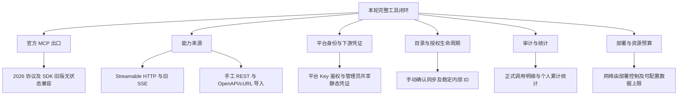

# MCP 网关与 REST 转 MCP 接入规格

## 状态

2026-11-22，依据本次 `grill-xx:grilling` 澄清形成。

各项产品决定已逐轮确认。2026-11-22，用户确认“开始吧就在当前分支开始”，整体规格与 [TDD 测试边界](20261122-mcp-tdd-boundaries.md)生效，进入实施。本次依用户指示继续使用当前分支 `dev_mcp_research_261121`。本文定义目标行为，不表示功能已经全部实现。

## 关联文档与阶段关系

- [产品方向稿](agent-capability-platform/spec.md)记录完整产品方向。本规格细化本轮 MCP 与 REST 接入，不包含 Skills 来源接入或 A2A。
- [管理员认证与首个业务阶段](20261121-admin-auth-and-first-business-loop.md)继续作为本地账号、用户/角色、网页会话和 API Key 的依据。该文的 demo 阶段是已完成的前一阶段，本轮建立真实接入能力。
- [技术选型](20261121-technology-selection.md)中的 TypeScript、Express、React/Vite、SQLite/Kysely 和 pnpm workspace 继续采用。
- [MCP 调研报告](20261122-mcp-research.md)作为参考证据。调研建议与本文取舍不一致时，整体确认后的产品行为以本文为准；调研原文保留。

## 交付目标与范围

原生 MCP 与 REST 转 MCP **同一轮交付，按依赖顺序实施**。

验收闭环：管理员登记服务或导入 REST 操作 → 审阅并确认工具定义 → 分配角色工具授权 → 普通用户通过自己的 API Key 发现并调用工具 → 正式调用形成审计 → 管理员查看明细、用户查看自己的累计统计。

本轮包含：

1. 原生 MCP 下游登记、连接、工具发现、同步预览、确认、启停与删除。
2. REST 手工定义、OpenAPI JSON/YAML 导入、cURL 导入、预览编辑与确认。
3. 上游 MCP 工具发现与调用、当前角色授权过滤、调用二次鉴权。
4. 服务级静态 HTTP 凭证、管理员试调用、正式调用审计。
5. 对应管理控制台、用户调用统计及接入文档。

本轮的边界：

- 只代理普通工具调用，不代理 resources、prompts、中途要求用户补充输入的交互、MRTR 或未实现的扩展能力。遇到未支持的交互，明确返回原因。
- 原生 MCP 工具的文本、图片、音频、结构化内容等按 MCP 语义保留，不能把所有结果改成普通文本。
- REST 请求只支持 JSON body 与本规格列明的 path/query/header 参数；REST 响应只支持 JSON、普通文本和无正文响应，不转换二进制文件或图片。
- 不提供 stdio 接入、Agent 进程托管或普通 HTTP 代理出口。
- 用户个人下游凭证、自动登录、OAuth token 获取/刷新和其他动态凭证策略留作后续扩展。

## 设计树与已收敛分支



## MCP 协议与验收依据

- 上游提供 Streamable HTTP，以最新正式协议 `2026-07-28` 为主。
- 使用官方 MCP TypeScript SDK 的旧版 Streamable HTTP **无状态兼容**，不额外实现旧版有状态上游会话、GET 通知流和 DELETE 会话机制。
- 下游支持 Streamable HTTP 与旧 HTTP+SSE。旧 SSE 所需的连接会话由下游客户端管理。
- 两端的协议版本、请求 ID、认证与连接独立。服务端声明其实际支持的 capabilities。
- 网关协议符合性、官方 SDK 客户端与受控协议夹具是验收依据；**不要求 Claude Code、Codex 或其他 Agent 的专项兼容测试**。
- 接入文档提供 Claude Code 与 Codex 配置说明。文档不能把客户端自身不支持的功能描述成网关承诺。
- 独立调用或工具参数中的显式 handle 可以关联业务状态；不保证旧下游依赖连接会话的隐式连续调用，不承诺自动按聊天隔离状态。

具体 SDK 发布版本在技术验证时锁定。本轮已有文档和 main 源码调研，尚未运行发布包；版本差异属于待验证事实，不交给用户猜测。

## 身份、凭证与扩展边界

- 网页使用现有账号密码会话；MCP 使用现有平台 API Key Bearer 鉴权。
- Key 和所属用户是平台调用身份。每个正式请求读取当前用户状态与角色授权，客户端名称/版本只是可选来源标签。
- 原生 MCP 与 REST 下游当前都由管理员配置无鉴权或服务级静态 HTTP 请求头。Basic、Bearer、API Key 可以通过对应头表达。
- 同一服务的调用者共享该服务凭证；不自动把入站平台 Bearer Key 转发给下游。
- 下游凭证以**明文存入 SQLite**，保护依靠部署环境及数据库访问控制。本轮不引入凭证加密主密钥。
- 管理员配置的静态凭证头独立注入，不能被工具调用参数覆盖。
- 调用适配器通过统一凭证解析入口获取当前服务凭证，并接收调用者上下文。当前仅实现管理员配置来源；未来在此入口增加用户凭证来源，避免改写平台身份判断、角色过滤和两个执行适配器。
- 当前授权粒度是工具，不实现下游业务数据字段级授权。

## 服务与工具目录

### 标识和命名空间

- 服务和工具使用稳定内部 ID；下游原名、REST 操作身份和网关公开调用名分别保存。
- 工具公开名称始终带服务命名空间，例如 `github__search`。
- 命名空间自动生成建议值，管理员首次保存前和保存后都可以修改；保存时验证合法性与唯一性。
- 保存命名空间变更前展示受影响的工具名称。变更后新名生效，旧名失效，**不维护旧名别名**。
- 命名空间改名保留服务/工具内部 ID、已有授权与历史统计；历史记录保留调用当时的名称。
- 公开名遵循官方工具名称规则，并保存明确路由映射，不靠公开名替代资源身份或授权依据。

### 登记、同步和删除

- MCP 地址不可达或凭证错误时，允许保存未连接配置，管理员可修正、测试与同步。
- 正式工具目录来自管理员确认的发现结果。原生 MCP 工具发现覆盖分页。
- 工具变化由管理员主动同步、查看新增/修改/删除差异后确认。
- 原名相同的 MCP 工具更新 schema/说明，保留内部 ID 和已有授权。
- 新工具默认不授予普通角色；固定管理员按既有规则拥有管理与工具权限。
- 确认删除工具后清理该工具授权；以后重现按新工具处理，需重新授权。
- 发现失败、分页不完整或断线不作为删除依据，不清空持久目录与授权。
- 旧连接的迟到发现结果不能覆盖当前配置或较新的同步结果。
- 服务/工具删除不删除历史审计和统计。

### 连接恢复与可用性

- MCP 下游断线后自动退避重连。恢复连接不自动应用目录变化。
- 认证失败保留管理员配置并提示处理，不删除凭证，不把认证拒绝当作更换传输的依据。
- 原生 MCP 未连接成功、被停用的工具不进入可调用列表；一个服务失效不影响其他可用服务。
- REST 配置校验通过且管理员启用后即可调用，不强制成功试调用，也不自动请求业务接口做健康检查。
- REST 实际 HTTP 失败作为单次失败返回，不因此永久停用整个服务。
- 配置变化、服务删除和程序关闭时释放不再使用的 client、transport、订阅与恢复任务。配置变化和停用后，旧 client 等其已发调用完成或超时再释放，不通过立即关闭连接取消这些调用；在途规则优先。

## 授权与在途调用

- 继承现有多角色权限并集和默认拒绝规则。
- 工具列表按当前身份、精确工具授权和服务状态过滤；正式调用再次执行同一授权判断。
- 服务目录授权不自动开放所有子工具；工具授权可使所属服务出现在目录中。
- 停用服务、吊销 Key、停用用户或修改角色授权时，立即阻止受影响的新调用。
- 已发出的调用允许完成或超时，不承诺撤回。调用者主动取消时尝试向下游传递取消，不承诺业务回滚。

## REST 操作定义与执行

### 参数契约

手工定义和所有导入来源生成同一种内部操作定义，包含目标服务、HTTP 方法、相对路径模板、工具名、说明、参数 schema、必填项、JSON body schema 和可选试调用示例。

MCP 工具参数统一分组：

```json
{
  "path": {"id": "42"},
  "query": {"limit": 10},
  "headers": {"X-Tenant": "team-a"},
  "body": {"name": "Alice"}
}
```

- 无参数的组可以省略；省略可选 body 不自动发送空对象。
- 保留不同位置的同名参数，按 `(name, in)` 处理 OpenAPI 参数继承与覆盖。
- path/header 支持标量；query 支持标量与 `form` 数组。
- 数组 `explode=true` 使用重复 query 键，`false` 使用逗号列表；按照声明编码。
- 对象型 path/query/header、其他 style 和 cookie 参数明确提示不支持；JSON body 内的对象、数组正常支持。
- 路径参数独立编码。OpenAPI 路径追加到 server URL，不能丢掉 server 的 base path。
- 参数在发往下游前按定义校验，不丢弃约束或静默更换序列化方法。

### 示例与默认值

- 可选示例用于管理员试调用预填，不改变正式调用。
- 导入出的类型、必填项与示例允许管理员在预览中调整；确认后才保存。
- 正式调用不自动使用示例，也不补入默认参数。
- 导入文档的 `default` 作为 schema 注解处理，不自动启用赋值。Q43 中的“默认值”不能被解释为推翻 Q35 已选定的示例用途。

### 响应与成功判定

- 支持 JSON、普通文本和无正文响应，例如 204。
- REST 正文原样放入标准 MCP 工具结果，**不增加 `{status, body}` 等业务外壳**。
- REST 成功只按 HTTP 状态判定：2xx 是 HTTP 成功，非 2xx 返回 `isError`。不自动识别 JSON 业务码，也不增加可配置业务码判定功能。
- 未收到响应、超时、超出已选资源预算或无法完成转换时明确返回失败原因，不伪造成功结果。
- 网关失败不表示下游没有产生业务副作用。审计的成功/失败表示网关调用结果，不证明业务回滚。
- 原生 MCP 输出保留其 content、structuredContent、isError 及已支持的协议语义；REST 正文透传不能用来替代原生 MCP 的媒体和结构化结果。

## 导入契约

### 输入与预览

- OpenAPI 接受粘贴 JSON/YAML、上传文件、填写文档 URL；cURL 接受粘贴文本。
- OpenAPI 支持 3.0.x、3.1.x；Swagger 2.0 和其他版本明确提示未支持。
- 所有来源经过统一解析、规范化、验证、预览与确认，不保留行为不同的旧执行路径。
- 预览显示操作、目标、参数来源、类型、必填项、schema、示例、凭证配置及新增/修改差异。
- **OpenAPI 和 cURL 解析后的参数必须经管理员确认才能保存**，不能解析后直接发布工具。
- 同一文档中允许选择可转换的操作；每个不支持的操作显示状态和原因，不能勾选，不静默跳过。
- 同一 OpenAPI 存在不同有效 server URL 时按目标分组，每组一个 REST 服务，各自确认命名空间和凭证。不忽略操作级 server 配置，不自动向所有组复用一份凭证。

### Schema 与引用

- 转换保留 OpenAPI 3.0 与 3.1 各自的 schema 语义，正确处理 nullable、组合与请求方向约束。
- MCP schema 按声明方言或默认 JSON Schema 2020-12 验证；无法支持或无法保真的内容明确报告，不删掉约束伪装兼容。
- 支持文档内引用，包括递归引用。抽出操作 schema 后保持引用上下文自包含，可使用本地定义与引用，不无限展开递归。
- 本轮不自动读取外部文件或网络 `$ref`；无法解析的相关操作在预览中标明不可转换。
- 顶层文档不可解析、版本不支持或整体超出资源预算时阻止导入；正常文档内单个操作不支持时按部分导入规则处理。

### cURL 推断

- 只解析单条 cURL 中的 URL、方法、请求头、query 与 JSON body，不执行 shell。
- 不读取本机文件或环境变量，不执行命令替换、管道、命令串联或 `@file` 等输入。需要展开的值在预览中提示补充。
- JSON body 按样例推断类型；query/header 初始按字符串处理，不把 `001` 自动变成数字。
- 不自动把 `/users/42` 中的 `42` 猜成路径参数；管理员可修改为 `/users/{id}` 并定义参数。
- 一条请求样例不足以证明必填项、枚举或取值范围；最终参数定义由管理员审阅确认。
- 凭证配置和工具输入分别处理，不把服务凭证变成供调用者覆盖的参数。

### 重导入

- 可选择新建服务或更新已有服务。
- REST 操作按 HTTP 方法与路径模板匹配，展示新增/修改；已有操作保留内部 ID 和授权。
- 本次未选择的既有操作不自动删除；删除必须明确确认。
- 新操作默认未授权；改名不重写历史统计。

## 试调用、审计与统计

### 管理员试调用

- 控制台提供参数输入、可选示例预填和结果查看，验证原生 MCP 接入与 REST 映射。
- 试调用由管理员网页会话授权，不允许普通调用者通过自报参数或 metadata 绕过正式审计。
- 连接测试、工具发现、管理员试调用和管理 API 不进入正式调用审计。

### 正式调用审计

- 正式工具调用成功和失败都记录，包含用户、服务、工具、时间、结果状态及可选客户端名称/版本标签。
- 状态为进行中、成功、失败、结果未知。
- 发往下游前必须能够建立审计记录；无法建立时拒绝发起调用。
- 工具已经执行而后续审计更新失败时返回实际工具结果，独立报告审计故障，不重新执行工具。
- 不保存参数与结果正文；不自行增加 HTTP 状态码、耗时、请求 ID、IP 或失败原因等审计字段。技术日志同样避免间接记录正文和凭证。
- 服务/工具删除、Key 吊销或命名空间改名不删除或重写历史记录。历史保存调用当时的名称。
- 首期不自动清理审计。程序重启后无法确认结果的未结束记录标记为结果未知，不假定成功，也不补执行。
- 管理员查看调用明细；普通用户不查看调用明细。

### 用户累计统计

- 普通用户仅查看自己的调用总次数、成功数和失败数。
- 按用户所有 API Key 汇总累计正式记录，包括已过期、已吊销 Key 的历史调用。
- 总次数包含已建立审计记录的调用尝试；成功数、失败数按对应终态统计。
- 进行中、结果未知不计入成功数或失败数，故总次数不必等于成功数与失败数之和。
- 管理员试调用不计入。

## 部署与资源预算

- 不添加程序级的上下游 IP/网段白名单、公网/内网过滤或单独网络可达性限制；网络访问由部署环境决定。
- 按 MCP 协议校验请求中的 Origin，允许的浏览器来源由部署者配置；没有 Origin 的请求正常处理。
- 正常协议格式、认证、HTTP(S) 和 TLS 处理仍使用所选 SDK/HTTP 客户端；不因网络自由而跳过已确认的入口校验。
- 普通工具调用默认超时 60 秒，管理员可按服务调整。超时或断线不自动重发工具调用；连接恢复与工具重新执行独立。
- 数据和解析预算可以通过部署配置调整，初始值如下：

| 预算 | 初始值 |
| --- | --- |
| 导入原文 | 10 MiB |
| 单次工具调用请求 | 10 MiB |
| 单次工具调用响应 | 10 MiB |
| schema 结构深度 | 64 |
| schema 节点数 | 100,000 |

预算检查不能只在完整正文读入内存后截断；超限明确失败。递归引用保持引用关系，不通过无限展开计算深度；不静默截断结果或移除 schema 约束。

## 实现顺序与验收目标

| 步骤 | 内容 | 验证目标 |
| --- | --- | --- |
| 1 | 官方 SDK 与协议基础 | 2026 上游、旧版无状态兼容、HTTP/SSE 下游；请求/结果语义、Origin、分页与资源释放符合契约 |
| 2 | 统一服务、工具与执行入口 | 稳定 ID、可改命名空间、凭证解析边界、精确授权、正式审计与默认预算贯通 |
| 3 | 原生 MCP 管理闭环 | 未连接保存、连接恢复、同步差异确认、新增默认拒绝、删除授权清理与管理员试调用 |
| 4 | 手工 REST 执行器 | 分组参数、编码、schema 校验、静态头优先、原文响应、2xx/isError 与超时不重发 |
| 5 | OpenAPI/cURL 导入 | 所有输入形式、内部/递归引用、目标分组、部分导入、确认后保存与重导入身份稳定 |
| 6 | 控制台、统计与接入文档 | 管理员明细、个人累计数字、试调用不审计及 Claude Code/Codex 配置说明 |

实施遵守仓库 TDD 和逐个小功能提交要求。测试包括：

- 普通用户列表过滤、直接越权调用拒绝、现有 Key 上角色变更生效。
- 命名空间保存后改名不丢授权和统计，旧名不再调用。
- 同步失败不误删、同名工具更新保留授权、删除后重现重新授权。
- SSE GET 与消息 POST 的凭证注入、连接/任务关闭与断线恢复。
- path/query/header 同名、数组两种 form 编码、false/0/空字符串/null 与可选 body 的准确处理。
- JSON/文本/204 和非 2xx 正文原样返回；写调用超时不重发。
- OpenAPI 版本、引用、方言、超限和不支持操作的明确诊断；cURL 不读取文件/环境或执行命令。
- 试调用不入审计；审计前置失败不执行；后置失败不丢实际结果；重启未结束记录为未知。
- 普通用户统计仅自己的全部 Key 历史，进行中/未知不算成功失败。

库 API、默认 validator 的实际覆盖、结果跨版本编码与流读取预算落实属于技术验证，不做 Agent 专项兼容测试；不能把调研源码存在当成测试通过。

## 决策修订记录

本次澄清保留调研原文，并明确采用以下不同取舍：

- 原生 MCP 与 REST 全部入口同轮交付，按依赖顺序推进，不分成两个产品交付轮次。
- 下游凭证明文保存，不采用调研建议的加密主密钥。
- 网络范围不由程序添加限制，保留协议 Origin 校验和已选资源预算。
- 命名空间自动建议、管理员可在保存后修改，不采用保存后不可变方案。
- 普通用户增加自己的累计统计，审计明细仍仅管理员可见。
- 默认示例仅用于试调用，不增加正式调用自动补默认值。
- REST 正文原样放入 MCP 工具结果，不采用 HTTP 状态与正文的自定义业务包装。

2026-11-22 最终确认：用户确认“开始吧就在当前分支开始”，按本规格和已提出的四个公共测试边界实施；使用当前分支，不另切分支。完成后仍等待用户确认再合入 main，不推送远端。
